# Agentic SDLC Orchestrator — URL Shortener

An **agentic software-engineering system** that takes a requirement and drives it through the full SDLC —
requirements → design → implementation → testing → documentation → release readiness — under explicit
governance, with a **production-grade URL shortener** as the system it builds and evolves.

Agents execute inside defined autonomy boundaries; humans own approvals, clarification of intent and final quality.

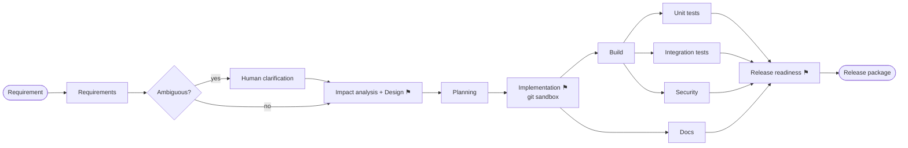

## Highlights

- **Stateful DAG orchestration** — parallel branches with joins, entry/exit gates, bounded retries, fallback agents,
  saga-style rollback, safe-stop and a global kill switch, dynamic re-planning.
- **Governance** — security, compliance and change-control policies on the *observed* diff; approvals with role risk
  ceilings and segregation of duties; hash-chained audit log; reliability metrics (success rate, retries, rollbacks,
  MTTR, p95 latency).
- **Three scenarios** — greenfield, brownfield (codebase impact analysis + schema change) and ambiguous (clarification
  stage inserted at run time), plus a policy-violation rollback demo.
- **Real verification** — agents build and test the modified code in a sandbox.
- **Scalable shortener** — Links API, Redirect service and Analytics worker behind an Ocelot gateway; SQL Server,
  two-tier Redis cache, Redis Streams; SSRF-safe URLs, owner tokens, rate limits, no raw IP storage.
- **Live dashboard** — animated execution graph, timeline, approvals, artifacts and decision lineage.
- **Delivered app, live** — every successful run deploys the released build to a preview URL with its own web UI
  (create links, analytics, disable) and Swagger.
- **No API keys required** — deterministic agents by default; optional Claude or OpenAI-compatible reasoning.

## Screenshots

**Control plane** — a brownfield run released and deployed to a live preview (left); a governed approval with policy
evidence (right).

| | |
|---|---|
| 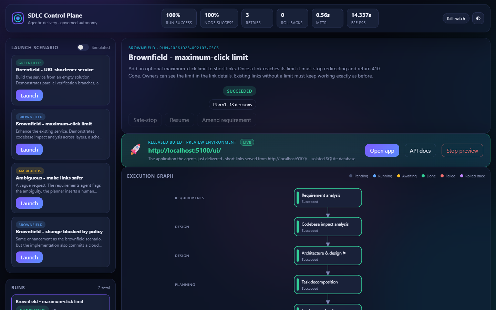 | 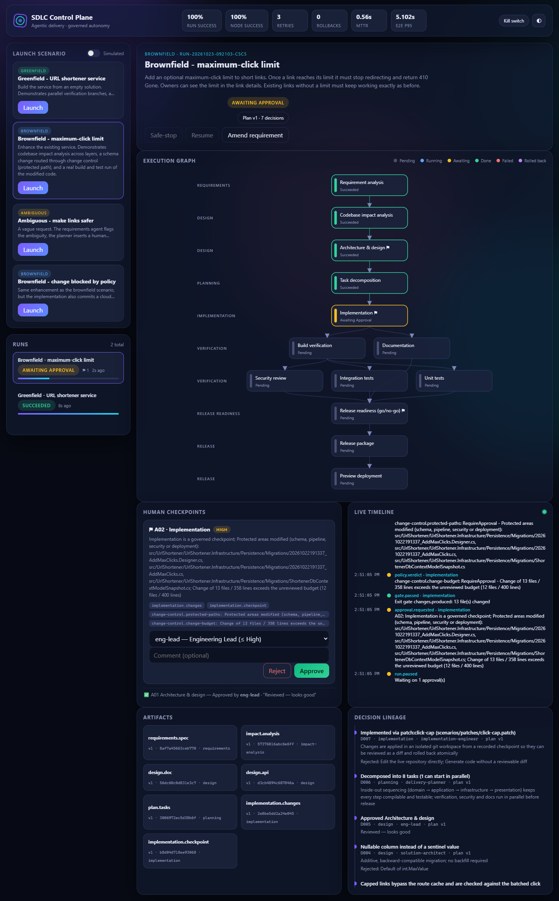 |
| Ambiguous request — clarification stage inserted at run time | Committed secret denied by policy and rolled back |
| 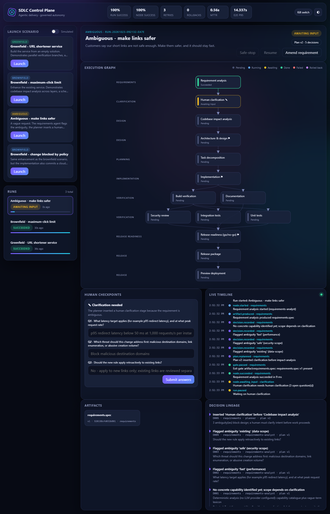 | 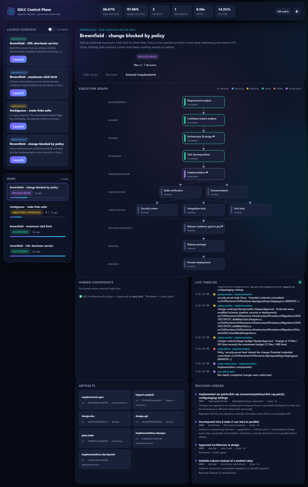 |
| Codebase impact analysis artifact | Release package — reviewable diff |
| 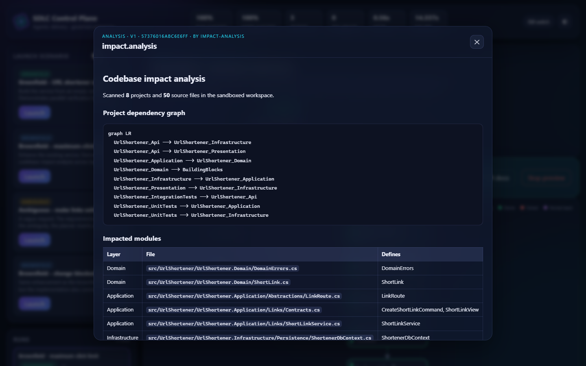 | 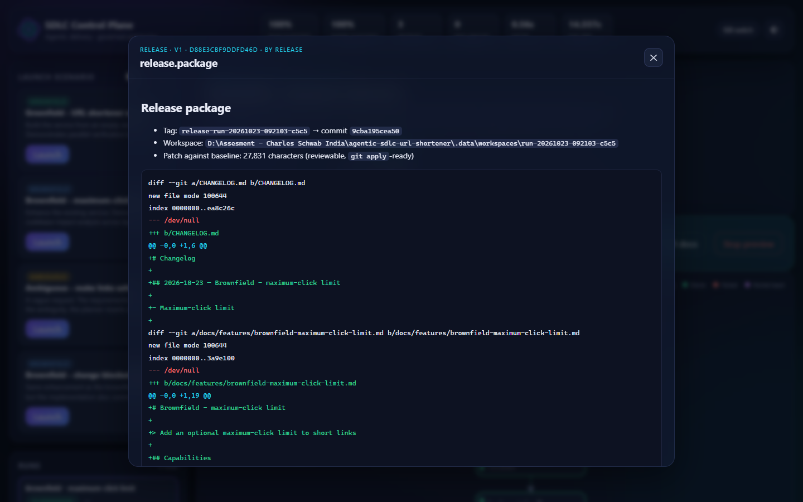 |

**The delivered application (Shortly)** — served from the preview environment of the run above, including the
*Max clicks* field the brownfield change added.

| | |
|---|---|
| 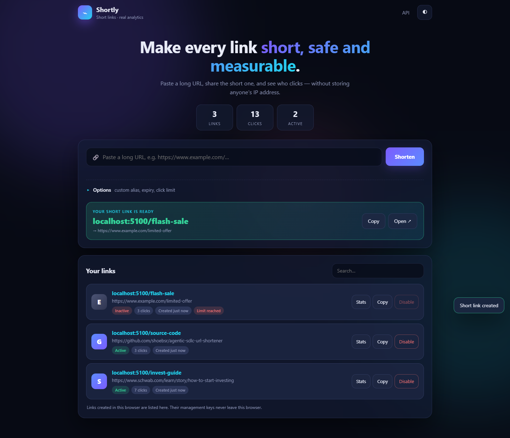 | 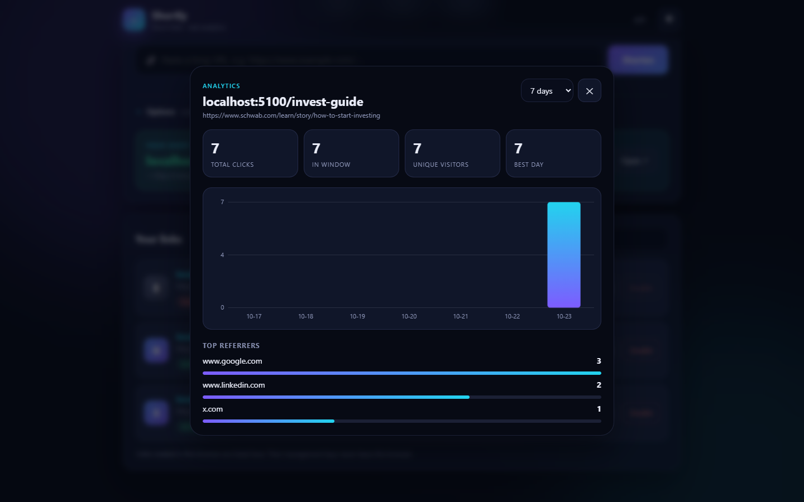 |

**Mobile**

| Shortly | Analytics sheet | Control plane |
|---|---|---|
| 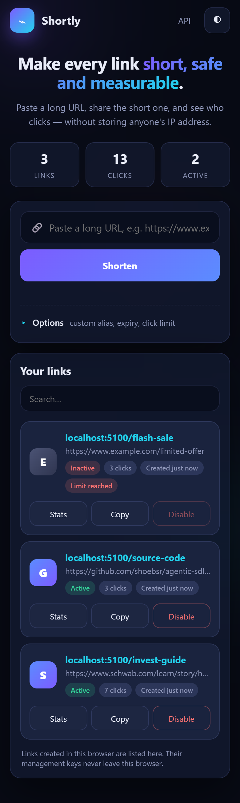 | 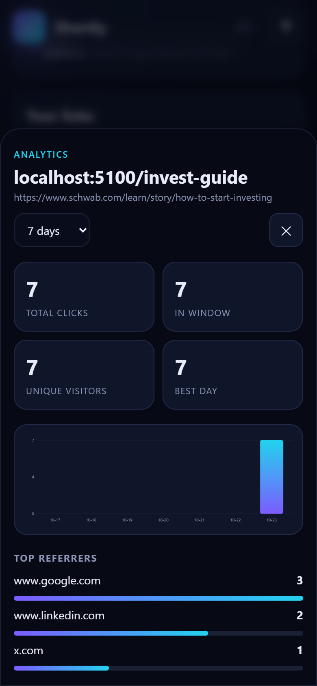 | 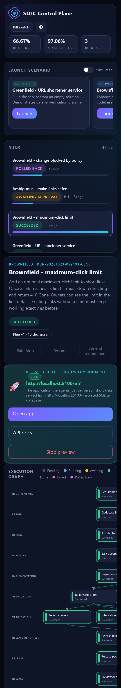 |

## Quick start

```powershell
dotnet build AgenticSdlc.sln
dotnet test AgenticSdlc.sln
dotnet run --project src/Orchestrator/Orchestrator.Host        # dashboard: http://localhost:5090
```

Shortener microservices with Docker:

```powershell
copy deploy\.env.example deploy\.env    # set your own values
docker compose -f deploy/docker-compose.yml up -d --build    # gateway: http://localhost:8080/swagger
```

Full instructions and a manual test walkthrough: [docs/11-setup-guide.md](docs/11-setup-guide.md).

## Documentation

| | |
|---|---|
| [Project plan](docs/01-project-plan.md) | [Architecture](docs/02-architecture.md) |
| [Flowcharts](docs/03-flowcharts.md) | [Orchestration model](docs/04-orchestration-model.md) |
| [Architecture decisions](docs/05-architecture-decisions.md) | [Scenarios](docs/06-scenarios.md) |
| [Data model](docs/07-data-model.md) | [Security](docs/08-security.md) |
| [Testing approach](docs/09-testing.md) | [Risks, trade-offs & limitations](docs/10-risks-and-tradeoffs.md) |
| [Setup guide](docs/11-setup-guide.md) | [Engineering summary](docs/12-engineering-summary.md) |

## Repository layout

```
src/Shared/BuildingBlocks/      Result and Error primitives
src/UrlShortener/               Domain, Application, Infrastructure, Presentation, Api, Redirect, AnalyticsWorker
src/Gateway/                    Ocelot API gateway
src/Orchestrator/               Core, Governance, Observability, Persistence, Agents, Host
tests/                          Unit and integration tests
scenarios/                      Scenario definitions and versioned change recipes
deploy/                         Dockerfile, docker-compose, .env.example
docs/                           Documentation
```

Author: **Shoeb Raza**
