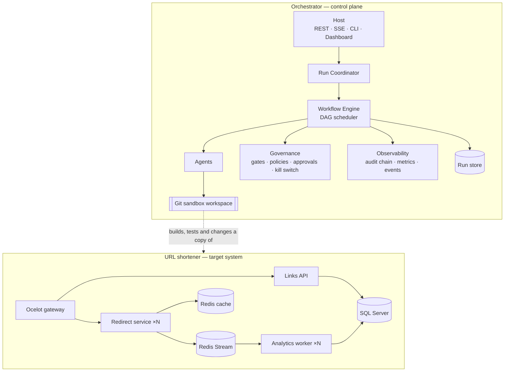
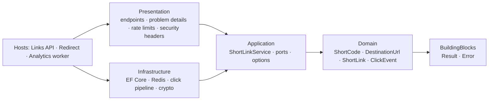
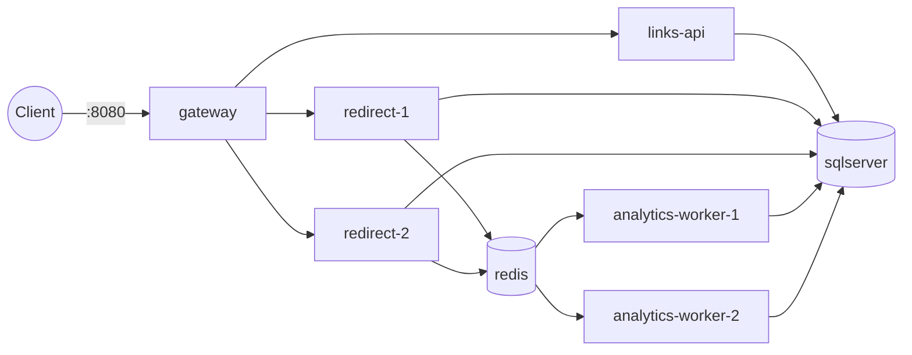
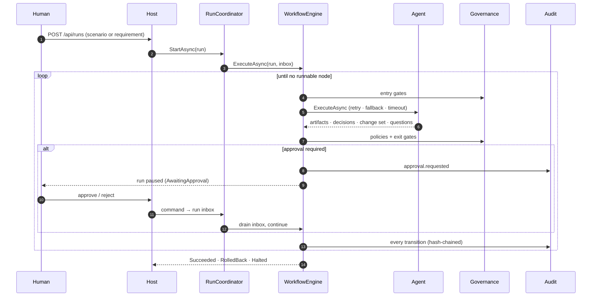

# 02 — Solution Architecture

## 1. Two bounded contexts

The **orchestrator** plans and governs work. The **shortener** is the product. The orchestrator never edits the
live repository: every run gets its own git-backed sandbox seeded from the repository, so changes are
reviewable as a diff and can be rolled back atomically.

## 2. URL shortener

### 2.1 Clean Architecture per service

- **Domain** has no dependencies. Invariants (code format, SSRF-safe URLs, expiry, disable) live in value objects and the aggregate.
- **Application** owns use cases and defines ports (`IShortLinkRepository`, `ILinkRouteCache`, `IClickTracker`, `IClickSink`, `IManagementTokenService`, …).
- **Infrastructure** implements the ports; the same code runs in two modes, chosen by configuration:

| Concern | Single process (local, tests) | Distributed (Docker) |
|---------|-------------------------------|----------------------|
| Route cache | In-memory | Two-tier: in-memory L1 + Redis L2 with pub/sub invalidation |
| Click capture | Bounded in-process channel + background writer | Redis Stream + consumer-group workers |
| Database | SQL Server or SQLite | SQL Server |

- **Presentation** is a shared library, so the Links API and the Redirect service reuse the same endpoints, error mapping, rate-limit policies, security headers and health checks.

### 2.2 Microservices and scaling

| Service | Responsibility | Scales by |
|---------|----------------|-----------|
| Gateway (Ocelot) | Single entry point, routing, timeouts, circuit breakers, trusted client address | Replicas behind a load balancer |
| Links API | Create, read, disable, analytics; applies migrations at start-up | Replicas (stateless) |
| Redirect | `GET /{code}` hot path, cache-first | Replicas (most traffic lands here) |
| Analytics worker | Consumes click stream, idempotent batch persistence | Consumer-group members |
| Redis | Shared cache and click stream | Managed Redis / cluster |
| SQL Server | System of record | Vertical, read replicas |

Write traffic (create) and read traffic (redirect) are separated, and click recording never blocks a redirect.
If Redis or the worker is slow or down, redirects still succeed and the dropped-click counter is logged.

### 2.3 Deployment (Docker Compose)

Start-up is health-gated: SQL Server and Redis must be healthy before the Links API starts; the Links API
must be healthy (migrations applied) before Redirect and workers start; the gateway starts last.

## 3. Orchestrator

### 3.1 Components

| Project | Responsibility |
|---------|----------------|
| `Orchestrator.Core` | Model (graph, run, artifacts, decisions, approvals), `WorkflowEngine`, `RunCoordinator`, per-run command inbox, journal |
| `Orchestrator.Governance` | Policy engine and policies, gate registry, approval authority (risk ceilings, segregation of duties), kill switch |
| `Orchestrator.Observability` | Hash-chained audit log, live event publisher, reliability metrics (`System.Diagnostics.Metrics`) |
| `Orchestrator.Persistence` | Atomic file-backed run store |
| `Orchestrator.Agents` | Agents, toolbox, git sandbox, capability catalogue, workflow templates, scenario loader, LLM adapters |
| `Orchestrator.Host` | REST API, server-sent events, headless CLI, dashboard, restart recovery |

Core depends on nothing but abstractions. Governance, observability, persistence and agents implement Core's
interfaces and are composed in the Host, so each can be replaced (e.g. a database run store, an OPA policy engine)
without touching the engine.

### 3.2 Control flow in one picture

### 3.3 Autonomy boundary

| Agents may | Agents may not |
|------------|----------------|
| Read and write files inside their run's sandbox | Touch the live repository or any path outside the sandbox |
| Run `dotnet` and `git` (allow-listed) inside the sandbox | Run any other executable; see secrets (environment is scrubbed) |
| Propose changes, decisions, questions and plan insertions | Approve anything; skip a gate; change policy |
| Retry transient failures within the node's budget | Retry beyond the budget or after a policy denial |

Humans own: architecture sign-off, approval of governed changes, release go/no-go, clarification of intent,
requirement changes, safe-stop and the global kill switch.

## 4. Cross-cutting concerns

| Concern | Approach |
|---------|----------|
| Configuration | Options classes validated at start-up (`ValidateOnStart`), environment overrides, secrets only via environment / `.env` |
| Errors | `Result<T>` with typed `Error` for expected failures; RFC 9457 problem details at the edge |
| Logging | Source-generated `LoggerMessage` |
| Observability | Health endpoints (`/health/live`, `/health/ready`), `System.Diagnostics.Metrics`, append-only audit |
| Build quality | Warnings as errors, .NET analyzers at `latest-recommended`, code style enforced in build |
