# 03 — Flowcharts

Every important runtime flow, end to end.

**Orchestrator**
1. [End-to-end SDLC run](#1-end-to-end-sdlc-run)
2. [Workflow graph per scenario](#2-workflow-graph-per-scenario)
3. [Node lifecycle](#3-node-lifecycle)
4. [Executing one node: gates, retries, fallback, policies](#4-executing-one-node-gates-retries-fallback-policies)
5. [Human approval](#5-human-approval)
6. [Ambiguity and dynamic re-planning](#6-ambiguity-and-dynamic-re-planning)
7. [Requirement amended mid-run](#7-requirement-amended-mid-run)
8. [Failure, rollback and compensation](#8-failure-rollback-and-compensation)
9. [Safe-stop, kill switch and restart recovery](#9-safe-stop-kill-switch-and-restart-recovery)
10. [Audit hash chain](#10-audit-hash-chain)

**URL shortener**

11. [Create a short link](#11-create-a-short-link)
12. [Redirect (hot path)](#12-redirect-hot-path)
13. [Click analytics pipeline](#13-click-analytics-pipeline)

---

## 1. End-to-end SDLC run

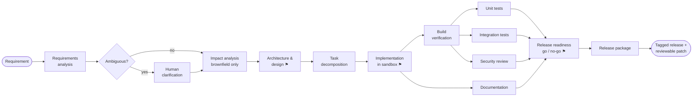

⚑ = human approval checkpoint. Implementation is approved when it is brownfield or when a policy escalates it.

## 2. Workflow graph per scenario

| Scenario | Nodes | Parallel branches | Approvals |
|----------|-------|-------------------|-----------|
| Greenfield | 11 | build ‖ docs, then unit ‖ integration ‖ security | design, implementation (policy-escalated: change budget, protected paths), go/no-go |
| Brownfield | 12 (adds impact analysis) | same | design, implementation (change control + migration), go/no-go |
| Ambiguous | 12 + clarification inserted at run time | same | clarification answers, design, implementation, go/no-go |

## 3. Node lifecycle

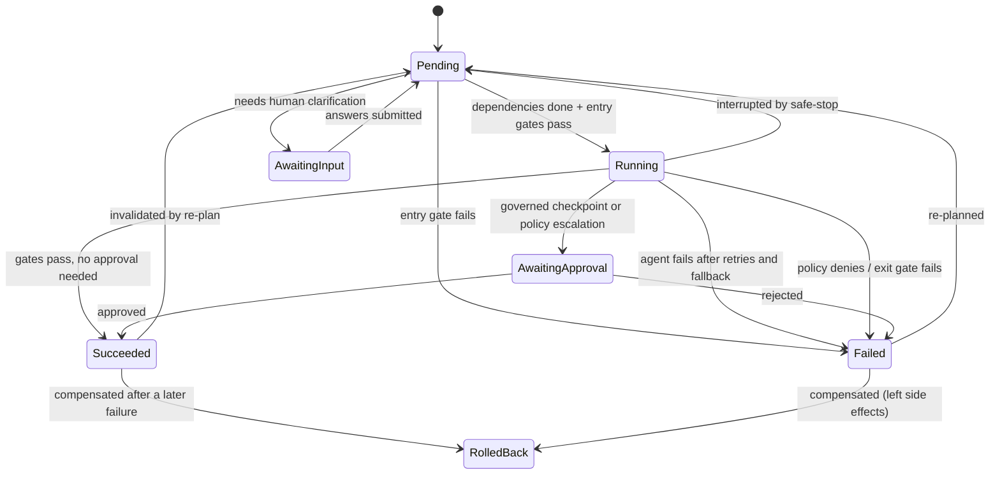

## 4. Executing one node: gates, retries, fallback, policies

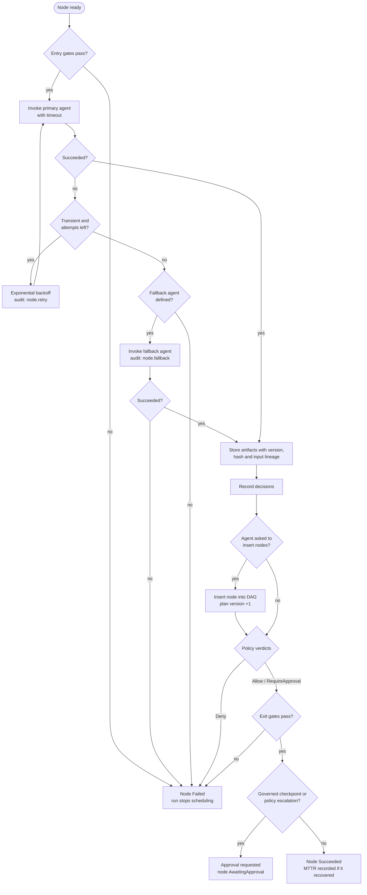

## 5. Human approval

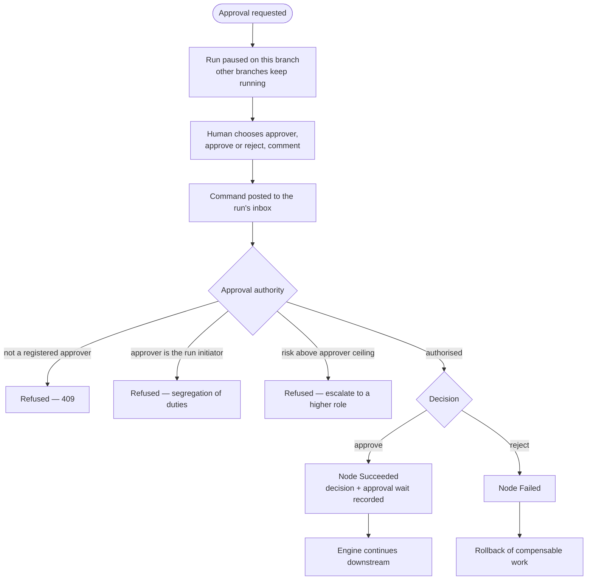

## 6. Ambiguity and dynamic re-planning

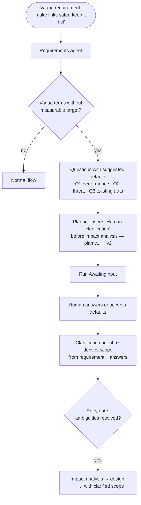

## 7. Requirement amended mid-run

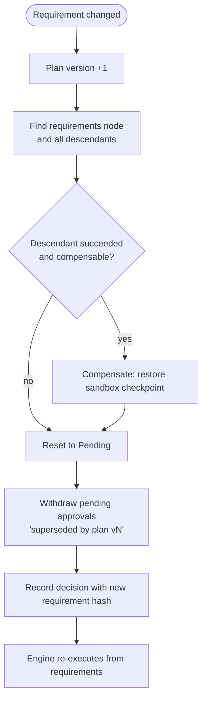

Re-planning also triggers automatically when a node re-executes and its output hash changes: its succeeded
descendants are invalidated because they were derived from the old output.

## 8. Failure, rollback and compensation

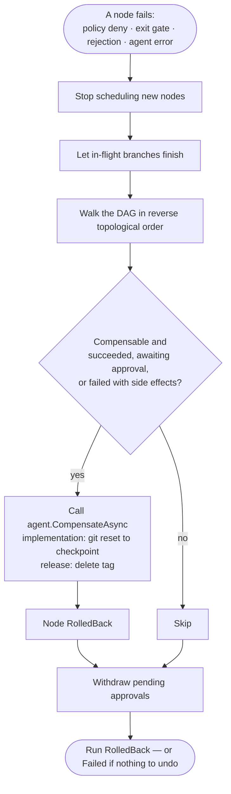

## 9. Safe-stop, kill switch and restart recovery

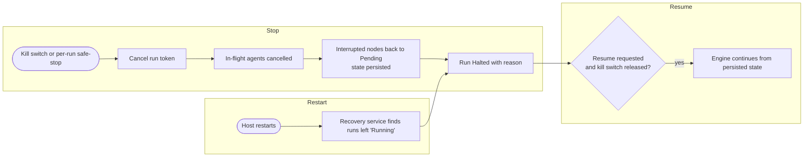

## 10. Audit hash chain

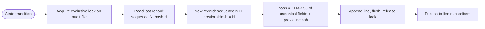

`GET /api/audit/verify` recomputes every hash; editing or deleting any past record breaks the chain at that sequence.

## 11. Create a short link

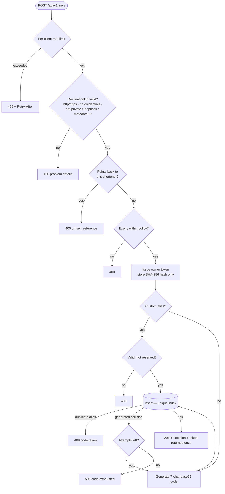

## 12. Redirect (hot path)

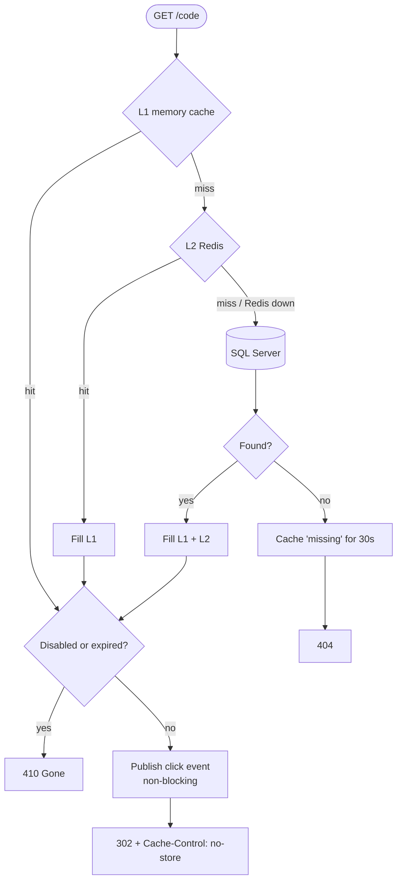

## 13. Click analytics pipeline

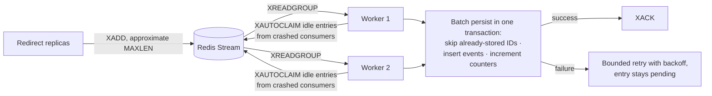

Delivery is at-least-once; persistence is idempotent on the click ID, so redelivery never double-counts.
