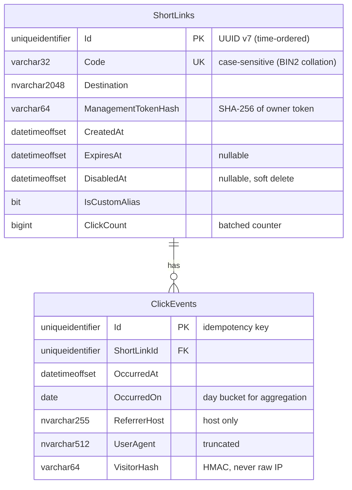
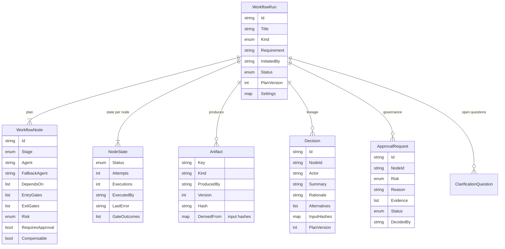

# 07 — Data Model

## 1. URL shortener (SQL Server)

| Design choice | Reason |
|---------------|--------|
| UUID v7 keys | Insert-friendly ordering without exposing a sequence |
| Unique index on `Code` with binary collation | Case-sensitive codes; collisions detected by the database, not by a racy read |
| Soft delete via `DisabledAt` | Analytics history retained; a disabled code is never reissued |
| `ClickCount` denormalised | Link details and caps read one row; updated in the same transaction as the events |
| `OccurredOn` day bucket + index `(ShortLinkId, OccurredOn)` | Daily series and window queries are index range scans |
| Referrer host only | Full referrer URLs can carry tokens |
| `VisitorHash` | Unique visitors without storing personal data |

Migrations: `InitialCreate` (baseline). Brownfield scenario adds `AddMaxClicks` (nullable `int`, additive).

## 2. Orchestrator run state

Storage layout (under the data root, default `.data/`):

| Path | Content |
|------|---------|
| `runs/<runId>.json` | Full run state, written atomically after every transition |
| `audit.jsonl` | Append-only, hash-chained audit records for all runs |
| `workspaces/<runId>/` | Git sandbox for the run (baseline commit, checkpoints, release tag) |
