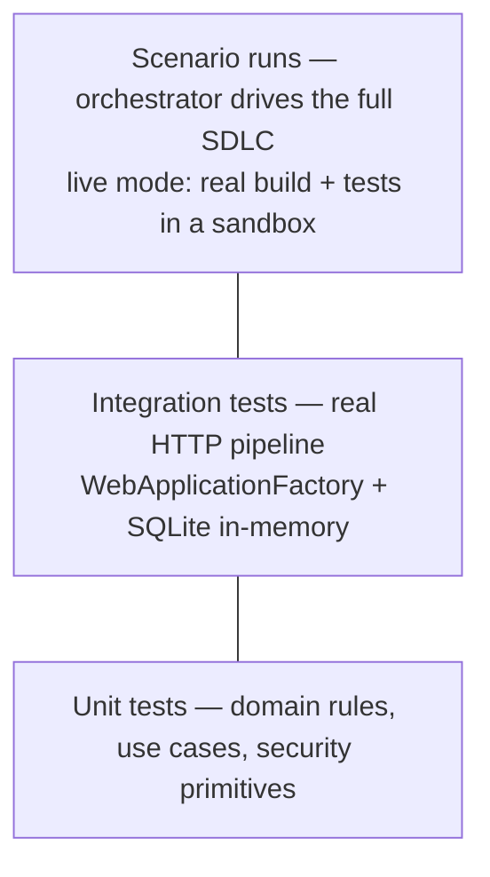

# 09 — Testing Approach

## 1. Pyramid



| Level | Project | Count (baseline) | Speed |
|-------|---------|------------------|-------|
| Unit | `tests/UrlShortener.UnitTests` | 61 | < 1 s |
| Integration | `tests/UrlShortener.IntegrationTests` | 12 | ~3 s |
| Scenario (orchestrated) | `Orchestrator.Host run <scenario>` | 4 scenarios | ~2 s simulated, ~30 s live |

The brownfield and ambiguous change recipes add their own tests (click-cap: +6 unit, +4 integration;
blocklist: +7 unit, +1 integration), which run inside the sandbox when those scenarios execute live.

## 2. What the shortener tests cover

| Area | Examples |
|------|----------|
| Domain invariants | Code length, character set, reserved routes, case sensitivity; expiry in the past; disable idempotency |
| URL safety | 19 rejected inputs: `javascript:`, `data:`, `file:`, credentials, loopback, RFC 1918, metadata IP, IPv6 ULA, IPv4-mapped, `.local`, `.internal`, over-long |
| Use cases | Generated-code collision retry and bounded give-up; alias conflict; self-reference; expiry policy; owner-only management; disable invalidates cache; redirect succeeds when analytics is saturated |
| Security primitives | Token entropy and hash-only storage; constant-time verify; HMAC fingerprint is keyed and never contains the address; 10,000 generated codes are unique |
| HTTP pipeline | 201 + Location; problem details with stable codes; 409 duplicate alias; 404 vs reserved path; 403 without token; 410 after disable; security headers and no server banner; oversized body rejected; readiness reports database; OpenAPI published |
| Asynchronous analytics | Clicks flow through the background pipeline into the analytics endpoint (polls until both counters converge) |
| Rate limiting | Third request in a minute window returns 429 with `Retry-After` |

Tests use a manual `TimeProvider` for time-dependent rules and in-memory fakes for ports, so unit tests have no I/O.

## 3. How orchestration is validated

| Property | Evidence |
|----------|----------|
| DAG order, parallel branches and join | Timeline shows verify ∥ docs, then unit ∥ integration ∥ security, joining at readiness |
| Approvals and authority | Run pauses at each governed checkpoint; self-approval and unregistered approvers are refused (409) |
| Policy enforcement | Protected-path escalation on migrations; secret-leak denial in the policy-violation scenario |
| Retry, fallback, MTTR | Greenfield fault plan: `requirements:primary` (fallback used) and `integration-tests:transient:1` (retry, recovery time recorded) |
| Rollback | Policy-violation scenario ends `RolledBack`; sandbox `git status` clean, injected file gone |
| Re-planning | Ambiguous scenario: plan v1 → v2 with inserted clarification node; amendment from the dashboard invalidates descendants |
| Real verification | Live brownfield run builds and tests the modified code; a genuine flaky test was caught by the gate (see [06-scenarios.md §5](06-scenarios.md#5-a-defect-the-orchestrator-found)) |
| Audit integrity | `GET /api/audit/verify` returns `intact: true` |
| Restart recovery | A run left `Running` by a crashed host is recovered as `Halted` and can be resumed |

### Fault injection

Any run can carry a fault plan (`settings.faults` or CLI `--faults`):

| Spec | Behaviour |
|------|-----------|
| `node:transient:N` | Primary agent fails the first N attempts, then succeeds (exercises retry + MTTR) |
| `node:primary` | Primary agent always fails; fallback agent runs (exercises fallback) |
| `node:fatal` | Every agent fails (exercises failure handling and rollback) |

Injected faults are written to the audit log as `fault.injected`, so they are never mistaken for real failures.

## 4. Running the tests

```powershell
dotnet test AgenticSdlc.sln
```

CI (`.github/workflows/ci.yml`) restores, builds in Release with warnings as errors, runs all tests with coverage
collection, uploads results, then builds every Docker image.

## 5. Gaps

| Gap | Mitigation today | Next step |
|-----|------------------|-----------|
| Orchestrator engine has no dedicated unit-test project yet | Validated through scenario runs with fault injection | Unit tests for graph validation, scheduling, retry/fallback, compensation, inbox, gates, policies, audit chain |
| No load test | Architecture reasoning, rate limits, async pipeline | k6 / NBomber against the Docker stack |
| No Testcontainers SQL Server suite | SQLite in-memory + live smoke tests against SQL Server | Testcontainers in CI |
