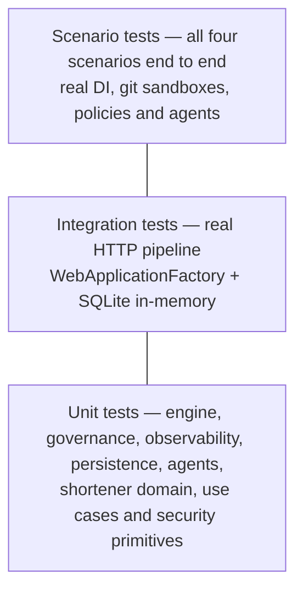

# 09 — Testing Approach

## 1. Pyramid



| Level | Project | Tests | Speed |
|-------|---------|-------|-------|
| Unit | `tests/Orchestrator.UnitTests` | 99 | ~1 s |
| Scenario | `tests/Orchestrator.ScenarioTests` | 7 | ~35 s |
| Unit | `tests/UrlShortener.UnitTests` | 61 | < 1 s |
| Integration | `tests/UrlShortener.IntegrationTests` | 12 | ~3 s |
| **Total** | | **179** | |

Live scenario runs (`Orchestrator.Host run <scenario>` without `--simulate`) additionally build and test the modified
shortener inside the sandbox (~30 s).

The brownfield and ambiguous change recipes add their own tests (click-cap: +6 unit, +4 integration;
blocklist: +7 unit, +1 integration), which run inside the sandbox when those scenarios execute live.

## 2. What the shortener tests cover

| Area | Examples |
|------|----------|
| Domain invariants | Code length, character set, reserved routes, case sensitivity; expiry in the past; disable idempotency |
| URL safety | 19 rejected inputs: `javascript:`, `data:`, `file:`, credentials, loopback, RFC 1918, metadata IP, IPv6 ULA, IPv4-mapped, `.local`, `.internal`, over-long |
| Use cases | Generated-code collision retry and bounded give-up; alias conflict; self-reference; expiry policy; owner-only management; disable invalidates cache; redirect succeeds when analytics is saturated |
| Security primitives | Token entropy and hash-only storage; constant-time verify; HMAC fingerprint is keyed and never contains the address; 10,000 generated codes are unique |
| HTTP pipeline | 201 + Location; problem details with stable codes; 409 duplicate alias; 404 vs reserved path; 403 without token; 410 after disable; security headers and no server banner; oversized body rejected; readiness reports database; OpenAPI published |
| Asynchronous analytics | Clicks flow through the background pipeline into the analytics endpoint (polls until both counters converge) |
| Rate limiting | Third request in a minute window returns 429 with `Retry-After` |

Tests use a manual `TimeProvider` for time-dependent rules and in-memory fakes for ports, so unit tests have no I/O.

## 3. What the orchestrator tests cover

Engine tests run real `WorkflowEngine`, `RunCoordinator`, gates, policies, approval authority, audit log and run
store; only the agents are scripted, so each behaviour is driven deterministically.

| Area | Examples |
|------|----------|
| Scheduling | Dependency order; two branches proven to run concurrently (each waits for the other to start); join sees both outputs |
| Resilience | Transient failures retried within budget with MTTR recorded; permanent failures not retried; fallback agent used after the primary is exhausted; agent that ignores cancellation still times out |
| Rollback | Compensation in reverse topological order; downstream never scheduled after a failure; `Failed` vs `RolledBack` |
| Lineage | Artifacts versioned and hashed with input lineage; decisions carry actor, plan version, alternatives and input hashes |
| Governance | Checkpoint pauses until an authorised approver; rejection rolls back; segregation of duties, unregistered approver and risk ceiling refusals; no double decision; policy deny compensates side effects; policy escalation raises risk with evidence; entry and exit gates; auto-approval ceiling; one branch's approval does not block a parallel branch |
| Re-planning | Ambiguity inserts a clarification node (plan v2) and waits; missing answers without defaults rejected; requirement amendment invalidates, compensates, withdraws approvals and re-runs with a single plan increment |
| Control | Safe-stop interrupts in-flight work and preserves completed work; resume does not redo completed nodes; kill switch blocks execution and resume until released |
| Graph | Topological order, cycle and unknown-dependency rejection, duplicate ids, descendants, insertion rewiring, insertion that would create a cycle |
| Policies | Each of the eight policies, including no false positive for the `Down()` migration and for configuration lookups of secrets |
| Audit | Chain verifies; editing a past record is detected at its sequence; two instances appending concurrently keep one intact chain; per-run reads; live publisher filtering |
| Metrics | Success, retry and rollback rates, MTTR, mean and p95 latency, per-stage failures |
| Persistence | Full round trip of run state; path-traversal run ids rejected; newest-first listing |
| Agents | Capability detection (greenfield, brownfield net-new only), ambiguity questions with defaults, measurable targets not flagged, unknown scope flagged, template DAG shape for each scenario kind, fault-plan parsing |

Scenario tests drive the real composition root (`AddOrchestrator`) with simulated build/test execution and assert
the business outcome of each scenario: brownfield released with a High-risk migration approval and `MaxClicks` in
the release patch; ambiguous re-planned to v2 and scoped to the blocklist; ambiguous run left unanswered stays in
`AwaitingInput` with no design produced; greenfield recovers through fallback and retry; the committed secret is
denied and the sandbox no longer contains the change; the initiator cannot approve their own run; and the released brownfield build is deployed to a live preview where a capped link is created and redirects.

### Defects found by these tests

| Defect | Fix |
|--------|-----|
| An agent that ignored its cancellation token could hold a node past its timeout and block safe-stop | The engine now abandons the agent task at the deadline or on safe-stop instead of relying on cooperation |
| Amending a requirement bumped the plan version twice | Re-planning on changed output only happens when there are settled descendants to invalidate |
| The vague-term lexicon missed comparative forms such as "safer" | Suffix matching now covers `-r`, `-er`, `-st`, `-est`, `-ly`, `-ness` |

## 4. How orchestration is validated end to end

| Property | Evidence |
|----------|----------|
| DAG order, parallel branches and join | Timeline shows verify ∥ docs, then unit ∥ integration ∥ security, joining at readiness |
| Approvals and authority | Run pauses at each governed checkpoint; self-approval and unregistered approvers are refused (409) |
| Policy enforcement | Protected-path escalation on migrations; secret-leak denial in the policy-violation scenario |
| Retry, fallback, MTTR | Greenfield fault plan: `requirements:primary` (fallback used) and `integration-tests:transient:1` (retry, recovery time recorded) |
| Rollback | Policy-violation scenario ends `RolledBack`; sandbox `git status` clean, injected file gone |
| Re-planning | Ambiguous scenario: plan v1 → v2 with inserted clarification node; amendment from the dashboard invalidates descendants |
| Real verification | Live brownfield run builds and tests the modified code; a genuine flaky test was caught by the gate (see [06-scenarios.md §5](06-scenarios.md#5-a-defect-the-orchestrator-found)) |
| Audit integrity | `GET /api/audit/verify` returns `intact: true` |
| Restart recovery | A run left `Running` by a crashed host is recovered as `Halted` and can be resumed |

### Fault injection

Any run can carry a fault plan (`settings.faults` or CLI `--faults`):

| Spec | Behaviour |
|------|-----------|
| `node:transient:N` | Primary agent fails the first N attempts, then succeeds (exercises retry + MTTR) |
| `node:primary` | Primary agent always fails; fallback agent runs (exercises fallback) |
| `node:fatal` | Every agent fails (exercises failure handling and rollback) |

Injected faults are written to the audit log as `fault.injected`, so they are never mistaken for real failures.

## 5. Running the tests

```powershell
dotnet test AgenticSdlc.sln
```

CI (`.github/workflows/ci.yml`) restores, builds in Release with warnings as errors, runs all tests with coverage
collection, uploads results, then builds every Docker image.

## 6. Gaps

| Gap | Mitigation today | Next step |
|-----|------------------|-----------|
| No load test | Architecture reasoning, rate limits, async pipeline | k6 / NBomber against the Docker stack |
| No Testcontainers SQL Server suite | SQLite in-memory + live smoke tests against SQL Server | Testcontainers in CI |
